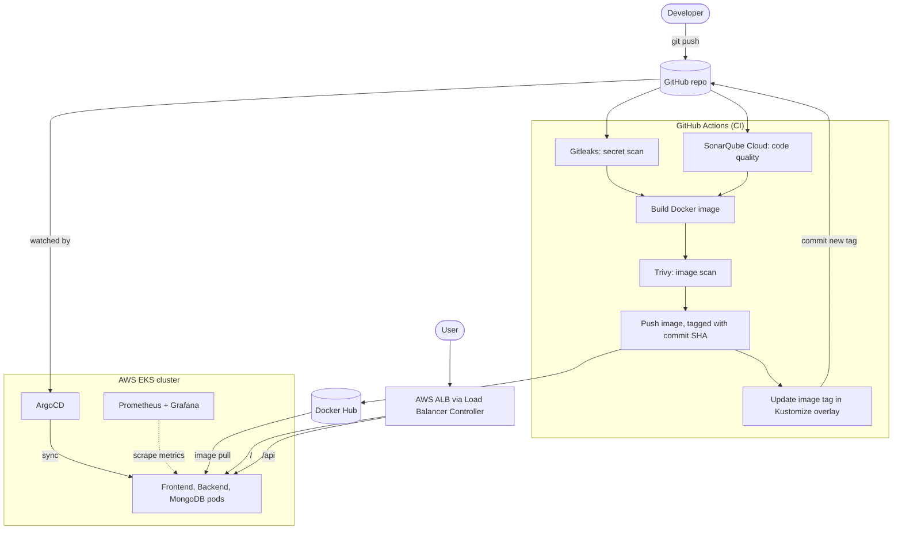

# Three-Tier App on AWS EKS: GitOps + DevSecOps Pipeline


An end-to-end delivery pipeline for a three-tier web application (React, Node.js, MongoDB) running on **AWS EKS**. Every push to `main` is scanned for secrets, code issues and image vulnerabilities, built into a container image, and deployed to the cluster by **ArgoCD** through git. **Prometheus and Grafana** provide observability.

> **Background:** the application code and the initial Kubernetes deployment come from the `#TWSThreeTierAppChallenge` from the TWS community. This repository extends that starting point into a complete GitOps and DevSecOps project: a GitHub Actions CI pipeline, security scanning, ArgoCD continuous delivery, sealed secrets, an ALB ingress and a monitoring stack.

---

## Table of contents

- [Three-Tier App on AWS EKS: GitOps + DevSecOps Pipeline](#three-tier-app-on-aws-eks-gitops--devsecops-pipeline)
  - [Table of contents](#table-of-contents)
  - [Architecture](#architecture)
  - [Tech stack](#tech-stack)
  - [Repository structure](#repository-structure)
  - [CI pipeline](#ci-pipeline)
  - [GitOps and continuous delivery](#gitops-and-continuous-delivery)
  - [Security](#security)
  - [Observability](#observability)
  - [Problems solved](#problems-solved)
  - [Deploy it yourself](#deploy-it-yourself)
    - [1. Create the cluster](#1-create-the-cluster)
    - [2. Configure GitHub](#2-configure-github)
    - [3. Install the cluster add-ons](#3-install-the-cluster-add-ons)
    - [4. Hand the repo to ArgoCD](#4-hand-the-repo-to-argocd)
    - [5. Open the app](#5-open-the-app)
  - [Teardown](#teardown)
  - [Known limitations and next steps](#known-limitations-and-next-steps)
  - [Credits](#credits)

---

## Architecture



**The key idea:** CI never touches the cluster. It builds, scans and pushes an image, then commits the new image tag back to git. ArgoCD, running inside the cluster, watches that same repo and applies the change. Git is the single source of truth for what runs in production.

**Request routing:** the ALB sends `/` to the frontend (nginx serving the static React build) and `/api` to the backend, so the browser talks to one address and the frontend calls the API with a relative URL (`/api/tasks`).

## Tech stack

| Area | Tools |
|---|---|
| Application | React (Material-UI), Node.js, Express, Mongoose, MongoDB |
| Containers | Docker (multi-stage build for the frontend), Docker Hub |
| Orchestration | AWS EKS (provisioned with `eksctl`), Kustomize |
| CI | GitHub Actions |
| CD / GitOps | ArgoCD |
| Security | Gitleaks, SonarQube Cloud, Trivy, Sealed Secrets |
| Ingress | AWS Load Balancer Controller (ALB) |
| Observability | Prometheus, Grafana (kube-prometheus-stack via Helm, deployed by ArgoCD) |

## Repository structure

```
.
├── .github/workflows/ci.yaml     # CI pipeline
├── Application-Code/
│   ├── backend/                  # Node.js + Express + Mongoose API
│   └── frontend/                 # React app (multi-stage build, served by nginx)
├── k8s-manifest/
│   ├── base/                     # Deployments, Services, Ingress, MongoDB, SealedSecret
│   └── overlays/dev/             # Kustomize overlay: namespace + image tags (updated by CI)
├── argocd/
│   ├── application.yaml          # ArgoCD Application for the app
│   └── monitoring.yaml           # ArgoCD Application for kube-prometheus-stack
├── sonar-project.properties      # SonarQube Cloud project config
└── .trivyignore                  # Documented, accepted CVEs (see Security)
```

## CI pipeline

The workflow is in `.github/workflows/ci.yaml` and runs on pushes to `main` that change `Application-Code/**` or the workflow file, or manually through `workflow_dispatch`. The path filter also stops the pipeline's own manifest commit from triggering another run.

```
secret-scan ──┐
              ├──► build-backend  ──┐
code-quality ─┘    build-frontend ──┴──► update-manifest
```

| Job | What it does |
|---|---|
| `secret-scan` | Gitleaks scans the full git history for leaked credentials |
| `code-quality` | SonarQube Cloud analyzes the source code (currently non-blocking, see limitations) |
| `build-backend` / `build-frontend` | Builds the image **locally without pushing**, scans it with Trivy, and pushes only if there are no CRITICAL or HIGH findings |
| `update-manifest` | Writes the new image tag into `k8s-manifest/overlays/dev/kustomization.yaml` with `yq` and commits it back to `main` (`[skip ci]`) |

Images are tagged with the **full commit SHA**, never `latest`. That is what makes the GitOps handoff work: a new SHA changes a file in git, and ArgoCD sees the change.

## GitOps and continuous delivery

- **Kustomize** structure: `base/` holds the manifests, `overlays/dev/` sets the namespace and overrides image tags.
- An **ArgoCD Application** (`argocd/application.yaml`) watches `k8s-manifest/overlays/dev` on `main` with automated sync, `prune: true` and `selfHeal: true`, so manual edits in the cluster are reverted to match git.
- The **ALB** is created by the AWS Load Balancer Controller from the cluster's Ingress resource, using an IAM role bound to a Kubernetes service account.
- **Monitoring** is also deployed through ArgoCD (`argocd/monitoring.yaml`), with Server-Side Apply enabled because the chart's CRDs exceed the client-side apply annotation limit.

## Security

Security is checked at four points: source, code, image and secrets.

| Layer | Tool | Behavior |
|---|---|---|
| Secrets in git | **Gitleaks** | Blocks the pipeline if secrets are found |
| Code quality and security | **SonarQube Cloud** | Reports bugs, vulnerabilities and code smells |
| Container images | **Trivy** | Blocks the push on CRITICAL or HIGH findings |
| Secrets in the cluster | **Sealed Secrets** | Only encrypted secrets are committed; the in-cluster controller decrypts them |

Supply-chain hygiene: security-related GitHub Actions are pinned to exact versions (not floating tags), and the images use maintained base images (`node:24-alpine`, `nginx:alpine`).

Accepted risks are documented, not hidden. `.trivyignore` lists a few CVEs by ID with an explanation: they sit inside npm's own bundled dependencies in the Node image (build tooling, not reachable by the running app), and at least one has no upstream fix yet.

## Observability

kube-prometheus-stack provides Prometheus, Alertmanager and Grafana. Grafana dashboards show CPU and memory for the application pods in the `workshop` namespace. Control-plane scrape targets that EKS does not expose (etcd, scheduler, controller manager, kube-proxy) are disabled to avoid false alerts.

Access Grafana with a port-forward:

```bash
kubectl port-forward svc/kube-prometheus-stack-grafana -n monitoring 3000:80
```

## Problems solved

Real issues hit while building this, and how each was fixed:

| Problem | Root cause | Fix |
|---|---|---|
| Trivy reported 177 vulnerabilities on the frontend image | The image ran the React dev server (`npm start`), so the whole build toolchain shipped in production | Multi-stage build: compile with `npm run build`, serve only the static files from `nginx:alpine`. The scan went to zero |
| Trivy flagged critical OS-level CVEs | Base image `node:14` was end-of-life | Moved to `node:24-alpine`, patched npm in the image, and ran `apk upgrade` in the nginx stage |
| Gitleaks passed a repo that contained credentials | The credentials were base64-encoded and also written in plain text in a YAML comment; Gitleaks matches patterns, not meaning | Replaced the plain secret with a Sealed Secret and rotated the credentials |
| CI failed on `trivy-action@0.36.0` | Tags were reissued with a `v` prefix after a supply-chain incident on the action | Pinned to the exact `v0.36.0` tag |
| SonarQube action warned of a vulnerability | The version in use was affected by CVE-2025-59844 | Upgraded to a patched, exact-pinned version |
| SonarQube scan failed with "CI analysis while Automatic Analysis is enabled" | The two analysis modes conflict | Disabled Automatic Analysis for the project |
| Kustomize did not update image tags | The overlay's image names did not match the base manifests (old ECR paths) | Aligned image names in the base with the overlay |
| ALB never appeared; Ingress stuck in "Progressing" | The AWS Load Balancer Controller was not installed | Installed it with an IAM role for the service account |
| Helm install failed with a CRD conflict | CRDs applied with `kubectl` and then again by Helm 4 | Installed the chart with `--skip-crds` |
| ArgoCD and Prometheus CRDs failed with "annotations too long" | Client-side apply exceeds the 256 KB annotation limit | Used server-side apply |
| Frontend could not reach the API behind the ALB | API hostname was baked in at build time and tied to a single IP-based domain | Switched to a relative `/api/tasks` URL, passed as a build argument |
| Grafana crashed with connection errors | Memory limit too low (OOM) | Raised the memory limits |

## Deploy it yourself

**Prerequisites:** AWS account, AWS CLI, `kubectl`, `eksctl` (0.215.0 or later), Helm, `kubeseal`, a Docker Hub account, and a SonarQube Cloud project.

### 1. Create the cluster

```bash
eksctl create cluster --name three-tier-app --region ap-south-1 \
  --nodegroup-name standard-workers --node-type c7i-flex.large \
  --nodes 2 --nodes-min 2 --nodes-max 3 --managed
```

### 2. Configure GitHub

Repository **secrets**: `DOCKERHUB_USERNAME`, `DOCKERHUB_TOKEN`, `SONAR_TOKEN`.
Repository **variable**: `REACT_APP_BACKEND_URL` set to `/api/tasks`.
Also set **Settings → Actions → General → Workflow permissions** to read and write, so CI can commit the image tag.

### 3. Install the cluster add-ons

**ArgoCD**
```bash
kubectl create namespace argocd
kubectl apply -n argocd --server-side -f https://raw.githubusercontent.com/argoproj/argo-cd/stable/manifests/install.yaml
```

**Sealed Secrets** (then generate your own sealed secret with your own credentials)
```bash
kubectl apply -f https://github.com/bitnami/sealed-secrets/releases/download/v0.38.1/controller.yaml

kubectl create secret generic mongo-sec --namespace workshop \
  --from-literal=username='<username>' --from-literal=password='<strong-password>' \
  --dry-run=client -o yaml | kubeseal --format yaml > k8s-manifest/base/mongo-db/sealed-secret.yaml
```
A SealedSecret can only be decrypted by the cluster that sealed it, so re-seal after creating a new cluster.

**AWS Load Balancer Controller**
```bash
eksctl utils associate-iam-oidc-provider --region ap-south-1 --cluster three-tier-app --approve

curl -o iam_policy.json https://raw.githubusercontent.com/kubernetes-sigs/aws-load-balancer-controller/v2.14.1/docs/install/iam_policy.json
aws iam create-policy --policy-name AWSLoadBalancerControllerIAMPolicy --policy-document file://iam_policy.json

eksctl create iamserviceaccount --cluster three-tier-app --namespace kube-system \
  --name aws-load-balancer-controller \
  --attach-policy-arn arn:aws:iam::<ACCOUNT_ID>:policy/AWSLoadBalancerControllerIAMPolicy \
  --override-existing-serviceaccounts --region ap-south-1 --approve

helm repo add eks https://aws.github.io/eks-charts && helm repo update eks
kubectl apply -f https://raw.githubusercontent.com/aws/eks-charts/master/stable/aws-load-balancer-controller/crds/crds.yaml
helm install aws-load-balancer-controller eks/aws-load-balancer-controller -n kube-system \
  --set clusterName=three-tier-app --set serviceAccount.create=false \
  --set serviceAccount.name=aws-load-balancer-controller --version 1.14.0 --skip-crds
```

### 4. Hand the repo to ArgoCD

```bash
kubectl apply -f argocd/application.yaml
kubectl apply -f argocd/monitoring.yaml
```

### 5. Open the app

```bash
kubectl get ingress -n workshop
```
Open `http://<ADDRESS>` in a browser and add a task.

To reach ArgoCD:
```bash
kubectl port-forward svc/argocd-server -n argocd 8080:443
```

## Teardown

Order matters. The ALB is created by the Load Balancer Controller, so remove it before deleting the cluster:

```bash
kubectl delete application three-tier-app -n argocd
kubectl delete application kube-prometheus-stack -n argocd
kubectl delete ingress mainlb -n workshop
aws elbv2 describe-load-balancers --region ap-south-1 --query "LoadBalancers[].LoadBalancerName"   # wait until empty
eksctl delete cluster --name three-tier-app --region ap-south-1 --wait
```

EKS, nodes, the NAT gateway and the ALB all bill hourly, so tear down the cluster when you are not using it.

## Known limitations and next steps

- **No tests yet:** the SonarQube quality gate is non-blocking because the free plan cannot customize the gate and the repo has no test coverage. Next: add Jest tests with coverage reporting and make the gate blocking.
- **No persistent storage:** MongoDB and Prometheus use ephemeral storage, so data is lost when their pods restart. Next: install the EBS CSI driver and add persistent volumes.
- **HTTP only, no custom domain:** Next: Route 53 and ACM for HTTPS.
- **Single environment:** only a `dev` overlay exists. Next: add `staging` and `prod` overlays with promotion through git.
- **Create React App** is deprecated. Next: migrate the frontend to Vite.
- **More supply-chain hardening:** image signing and SBOMs, plus automated dependency updates.

## Credits

Application code and the initial deployment challenge: `#TWSThreeTierAppChallenge` (TWS community). Pipeline, security, GitOps and observability work: [@ShwetaMG](https://github.com/ShwetaMG).
